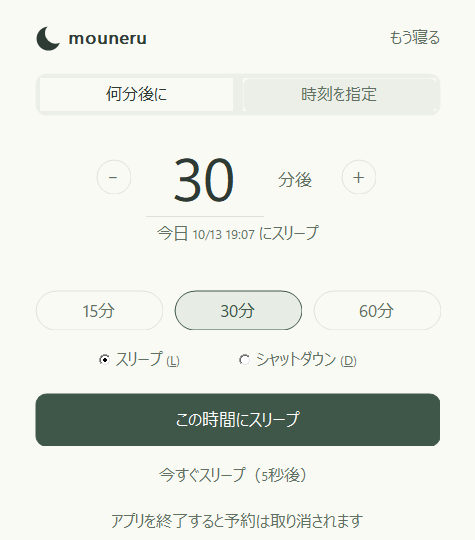

# もう寝る (MouNeru)

Windows 11用の、インストール不要で軽量な電源タイマーです。スリープとシャットダウンを選択でき、今すぐ実行する操作には5秒の取り消し時間があります。15・30・60分後、任意の分数後、または指定時刻に予約できます。

[もう寝るの紹介ページ](https://kyokutyou.com/mouneru.html)



## ダウンロード・起動

配布バージョンは **1.2.1** です。GitHub Releasesで配布する `MouNeru-1.2.1.zip` を展開し、`MouNeru.exe` を開くと使えます。インストールや追加ランタイムは不要です。

1.2.1の配布用EXEはコード署名なしです。Windowsが警告を表示する場合があります。配布するZIPのSHA-256ファイルでダウンロードしたZIPを確認でき、同梱の `MouNeru.exe.sha256` でEXEを確認できます。

## 使い方

1. 「何分後に」または「時刻を指定」を選びます。
2. 分数や時刻を入力します。15・30・60分のプリセットは分数を選択する操作です。
3. 予約ボタンの直前で「スリープ」または「シャットダウン」を選びます。
4. 実行予定日時と操作を確認し、「この時間にスリープ」または「この時間にシャットダウン」で予約します。

予約後は残り時間と取り消しを中心に表示します。「時間を変更する」から予約を編集できます。編集している間も元の予約は継続し、確定すると新旧の時刻を比較する確認が表示されます。予約中の終了にも確認が表示されます。

Tabで移動、分数・時刻の入力欄でEnterを押すと予約します。スリープ／シャットダウンの選択欄では矢印キーで切り替えられます。今すぐ実行の5秒カウントダウン中はEscapeで取り消せます。編集画面のEscapeは予約中の画面へ戻ります。DPI変更とWindowsの高コントラスト配色に対応しています。

## 主な機能

- スリープ／シャットダウンの選択
- 5秒間取り消せる「今すぐスリープ」「今すぐシャットダウン」
- 15分、30分、60分のプリセット
- 1～1,440分後の任意タイマー
- 24時間表記による時刻指定（過ぎた時刻は翌日）
- 実行予定日時と残り時間の表示
- 予約の置き換え・取り消し・終了確認
- 設定保存、ネットワーク通信、管理者権限は不要

予約はアプリが起動している間だけ有効です。アプリやPCを再起動すると復元されません。

PCを別の操作でスリープ・休止状態にした場合も、未実行の予約は取り消します。復帰後に古い予約を実行することはありません。再び実行したい場合は、新しく予約してください。予約の変更を確認している間にスリープした場合も、その確認から予約を復元しません。

同時に起動できるのは1つだけです。もう一度EXEを開くと、起動中の画面を表示します。別のプロセスに予約を作ることはありません。

「何分後に」と「今すぐ」の5秒は経過時間で計測するため、Windowsの時計変更では早まったり延びたりしません。「時刻を指定」はWindowsの時計に従います。

## 動作環境

- Windows 11 x64
- 追加ランタイム不要

Windowsの電源設定やデバイスの状態によっては、スリープ要求が拒否される場合があります。本アプリは他のアプリを強制終了しません。

シャットダウンはWindowsに通常の電源オフを要求します。未保存の作業があるアプリなどが終了を阻止すると、Windows側で確認が表示される場合があります。Windowsが要求を受け付けると本アプリは終了します。Windows側でシャットダウンを取り消した場合、予約は自動で再実行されません。

## ソースからビルド

必要なもの:

- Visual Studio 2022 Build Tools 17.8以降
- 「C++によるデスクトップ開発」ワークロード
- CMake 3.24以降
- Windows 11 SDK

「Developer PowerShell for VS 2022」で次を実行します。

```powershell
cmake -S . -B build -A x64
cmake --build build --config Release
ctest --test-dir build -C Release --output-on-failure
```

Release版は静的C/C++ランタイムを使用するため、`MouNeru.exe`単体で起動できます。

## リリース成果物

配布ZIPは `MouNeru-1.2.1.zip`、ZIPのチェックサムは `MouNeru-1.2.1.zip.sha256` です。EXEやZIPはソースリポジトリに含めず、GitHub Releasesの添付ファイルとして配布します。

現在の配布用EXEは署名なしです。署名済みEXEを作成する場合は [SIGNING.md](SIGNING.md) の手順を確認し、署名後にSHA-256チェックサムを生成します。

```powershell
Get-FileHash .\build\Release\MouNeru.exe -Algorithm SHA256 |
  ForEach-Object { "$($_.Hash.ToLower())  MouNeru.exe" } |
  Set-Content -Encoding ascii .\build\Release\MouNeru.exe.sha256
```

配布ZIPには次の4ファイルを含めます。

- `MouNeru.exe`
- `MouNeru.exe.sha256`
- `README.md`
- `LICENSE`

ビルド後、配布用フォルダへインストールできます。配布用READMEには `packaging/README.md` を使用します。

```powershell
cmake --install build --config Release --prefix out/MouNeru-1.2.1
Compress-Archive -Path .\out\MouNeru-1.2.1\* -DestinationPath .\out\MouNeru-1.2.1.zip -Force
Get-FileHash .\out\MouNeru-1.2.1.zip -Algorithm SHA256 |
  ForEach-Object { "$($_.Hash.ToLower())  MouNeru-1.2.1.zip" } |
  Set-Content -Encoding ascii .\out\MouNeru-1.2.1.zip.sha256
```

配布フォルダは上記の4ファイルだけの状態で梱包してください。

## 更新履歴

- **1.2.1**：スリープ・復帰時に未実行の予約を取り消し、複数起動を防止しました。分数タイマーと5秒カウントダウンがWindowsの時計変更に影響される不具合を修正しました。
- **1.2.0**：スリープ／シャットダウンの選択欄と、アプリ終了時に予約が取り消される説明を追加しました。
- **1.1.2**：Enterの長押しで予約や5秒カウントダウンが意図せず取り消される不具合を修正しました。
- **1.1.1**：＋／－の連打の取りこぼし、マウス操作時の四角いフォーカス枠、マウス移動時の点滅を修正しました。
- **1.1.0**：白とセージグリーンのコンパクトな画面に再構築しました。

## プライバシー

設定や予約はメモリ内だけに保持します。レジストリや設定ファイルへの保存、ログ収集、利用状況の送信、ネットワーク通信は行いません。

## ライセンス

[MIT License](LICENSE)
